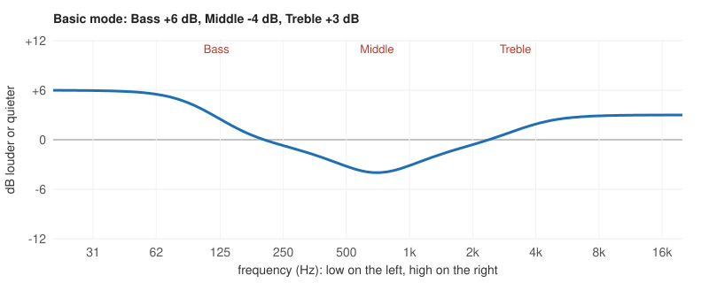

# Equalizer plugin

This plugin lets you change the tone of a track: more bass, less boxiness, a bit more sparkle. It works on any track, guitars, basses, drums or keys, whether the track plays a sound set alone or through an amp model. You set it per track in the track dialog's **Equalizer** section ([How to use it](use-cases.md) shows where), and it is saved with the song in its `.oxg` file beside it.

## What an equalizer does

Every sound is a mix of frequencies: low ones you feel as boom and body, middle ones that carry most of a guitar's character, high ones that give attack and air. Frequencies are measured in **hertz (Hz)**, vibrations per second. A bass guitar's low E is about 41 Hz, a guitar's top string about 330 Hz, and the fizz of a cymbal goes up past 10,000 Hz (10 kHz).

An **equalizer** (EQ) turns some of those frequencies up and others down. How much is measured in **decibels (dB)**: +6 dB doubles the signal's level, −6 dB halves it, and 0 dB leaves that part of the sound alone.

The bass, middle and treble knobs on a guitar amp are an equalizer. So are the sliders on an old hi-fi. The plugin has both kinds:

- **Basic** is an amp's *tone stack*: three knobs, **Bass** around 120 Hz, **Middle** around 700 Hz and **Treble** around 3.2 kHz. Bass and Treble are *shelves*: they lift or cut everything below or above their frequency. Middle is a *peak*: a hump or a dip around its frequency.
- **Graphic** has ten sliders an octave apart, 31 Hz to 16 kHz. Each octave doubles the frequency, so the sliders, side by side, draw a rough picture of what you are doing to the sound: hence "graphic".

## Why it's useful here

A sound set, especially a free one, can be harsh, thin or boomy, and an amp profile may be too dark or too bright for the song. The equalizer is the quickest fix, and since it costs almost nothing to run, it is the right tool on tracks where an amp model would be too heavy or makes no sense, like drums or keys.
