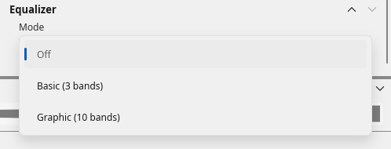
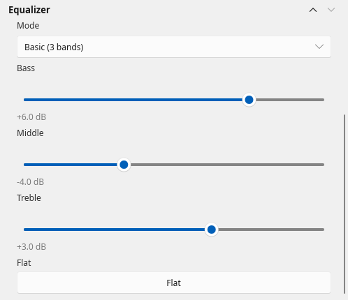
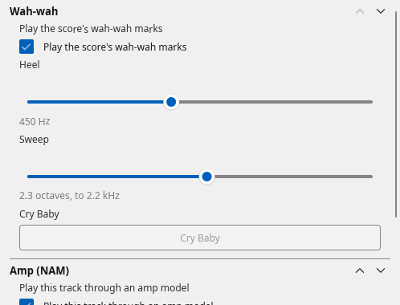

# How to use it

## Turn it on for a track

1. Click a note of the track you want to shape, and choose the **Track** tab on the right.
2. Scroll down to the **Equalizer** section and open **Mode**:

3. Pick **Basic** or **Graphic**, and move the sliders. Each goes from −12 to +12 dB in half-decibel steps. You hear the change at once, even while the song plays: each band glides to its new level in 20 ms, so nothing clicks.

**Flat** sets every band of the current mode back to 0 dB. Basic and Graphic each keep their own values, so you can switch between them and lose nothing. **Off**, the default, lets the track through untouched.

## Some starting points

| To | Try |
| --- | --- |
| Take the harshness off a fizzy distorted guitar | Treble −3 to −6 dB, or 4 kHz and 8 kHz down on Graphic |
| Give a thin sound set more body | Bass +3 dB |
| Make a guitar sit behind the vocals | Middle −2 to −4 dB |
| Make a guitar cut through a busy mix | Middle +2 to +4 dB |
| Tame a boomy bass | 62 Hz or 125 Hz down a few dB on Graphic |
| Add "air" to an acoustic guitar | 8 kHz and 16 kHz up a little on Graphic |

Small moves go a long way. If you find yourself pushing everything up, turn the track's volume up in the mixer instead.

## With an amp model

With the NAM plugin on the same track, the amp runs first and the equalizer shapes what comes out of it, as on a real rig with an EQ after the amp. The small arrows at the right of each section's title on the Track tab change the order:

## Good to know

- It works on any track: guitars, basses, drums, keys, anything a plugin plays.
- The settings are kept with the song, in its `.oxg` file beside it. The score itself doesn't change.
- They also apply to audio exports.
